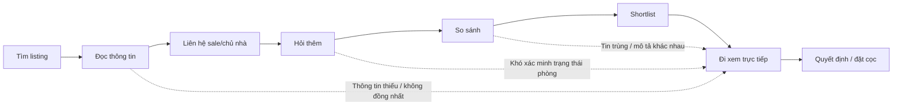
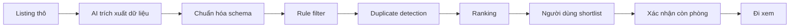

# Product Discovery Report  
## Giảm thời gian và số lần đi xem phòng không phù hợp khi tìm thuê phòng/căn hộ ngắn – trung hạn

> **Trạng thái hiện tại:** `NOT YET`  
> **Mục tiêu:** Xác định đúng bài toán trước khi quyết định có cần AI hay không.  
> **Nguyên tắc:** Problem first → Validation → Process → AI level → Decision.

---

## 1. Bối cảnh

Trong một tuần gần đây, tôi trực tiếp tìm phòng/căn hộ mới và gặp nhiều vấn đề trong quá trình tìm kiếm:

- Có quá nhiều nhân viên sale/môi giới cùng đăng hoặc giới thiệu phòng.
- Một căn có thể xuất hiện ở nhiều bài đăng khác nhau, đôi khi giá và mô tả không giống nhau.
- Ảnh/video trong bài đăng có thể khác đáng kể so với tình trạng thực tế.
- Các khoản như điện, nước, phí dịch vụ, gửi xe, Internet... không được trình bày thống nhất.
- Thông tin về tiện ích xung quanh như siêu thị, trường học, bệnh viện, bến xe... thường không có sẵn trong bài đăng.
- Người thuê phải tự liên hệ nhiều bên để hỏi lại cùng một nhóm thông tin.
- Có trường hợp đã đi xem và thấy phù hợp nhưng khi chuẩn bị đặt cọc thì phòng đã có người khác cọc trước.

Từ trải nghiệm này, vấn đề ban đầu tôi quan sát được không phải là **thiếu phòng để lựa chọn**, mà là:

> **Có quá nhiều thông tin nhưng quá ít thông tin đủ đáng tin để ra quyết định trước khi đi xem.**

---

## 2. Problem Card

| Trường | Nội dung |
|---|---|
| **Problem** | Người thuê phải mất nhiều thời gian lọc tin, liên hệ và đi xem vì thông tin listing thiếu chuẩn hóa, trùng lặp, không đầy đủ hoặc nhanh lỗi thời. |
| **Actor** | Sinh viên và người đi làm trẻ đang cần thuê phòng/căn hộ trong ngắn hoặc trung hạn. |
| **Bối cảnh** | Khi cần chuyển chỗ ở và phải tìm phòng trong thời gian tương đối ngắn qua Facebook, hội nhóm, môi giới, website hoặc các kênh đăng tin khác. |
| **Job Story** | Khi cần tìm chỗ ở mới, tôi muốn biết căn nào thực sự phù hợp với ngân sách, vị trí và nhu cầu sống trước khi đi xem, để không phải mất thời gian di chuyển tới nhiều căn rồi mới phát hiện không phù hợp. |
| **Quy trình hiện tại** | Tìm listing → đọc thông tin → liên hệ → hỏi thêm → so sánh → shortlist → đi xem → quyết định/đặt cọc. |
| **Bottleneck giả thuyết** | Các lỗ hổng dữ liệu ở bước tìm và so sánh chỉ được phát hiện rõ sau khi người thuê đã bỏ công đi xem. |
| **Impact quan sát được** | Phải liên hệ nhiều sale, gặp listing trùng, thông tin khác thực tế, phải đi lại nhiều nơi và có nguy cơ mất căn do trạng thái phòng thay đổi nhanh. |
| **Success Metric dự kiến** | Giảm số căn đi xem nhưng bị loại vì những lý do có thể biết trước; giảm thời gian tạo shortlist; tăng tỷ lệ căn đi xem đáp ứng tiêu chí ban đầu. |
| **Phương án không AI** | Chuẩn hóa form listing, checklist thông tin bắt buộc, bộ lọc cứng theo giá/vị trí/diện tích/chi phí/tiện ích. |
| **Giả thuyết AI** | AI hỗ trợ trích xuất dữ liệu từ bài đăng tự do, chuẩn hóa, phát hiện tin có khả năng trùng và hỗ trợ xếp hạng theo nhu cầu. |
| **Mức can thiệp cảm nhận ban đầu** | Workflow, nhưng **chưa phải quyết định cuối cùng**. |

---

## 3. Quy trình hiện tại



### Quan sát chính

Chi phí của dữ liệu kém thường xuất hiện rõ ở bước **đi xem trực tiếp**:

- Listing trùng khiến người thuê tưởng có nhiều lựa chọn hơn thực tế.
- Thông tin thiếu khiến phải nhắn hỏi lại.
- Chi phí không rõ khiến tổng ngân sách thực tế thay đổi.
- Ảnh/video có thể tạo kỳ vọng khác thực tế.
- Trạng thái phòng có thể đã thay đổi trước khi người thuê ra quyết định.

> **Lưu ý:** Hiện chưa có dữ liệu định lượng đủ để khẳng định bước đi xem là bước tốn thời gian nhất đối với mọi người thuê. Đây mới là quan sát từ trải nghiệm ban đầu.

---

## 4. Pain Points quan sát ban đầu

### 4.1. Tin đăng trùng

Một căn có thể được nhiều sale/môi giới đăng lại với:

- Giá khác nhau.
- Mô tả khác nhau.
- Ảnh khác nhau.
- Thông tin liên hệ khác nhau.

Điều này làm tăng nhiễu khi so sánh.

### 4.2. Thông tin thiếu

Các trường thường có thể thiếu:

- Diện tích thực tế.
- Tiền cọc.
- Thời hạn thuê tối thiểu.
- Giờ giấc ra vào.
- Lối đi riêng/chung.
- Nội thất đi kèm.
- Chính sách nuôi thú cưng.
- Tình trạng còn phòng.

### 4.3. Chi phí không minh bạch hoặc không đồng nhất

Ngoài giá thuê, người thuê còn phải quan tâm:

- Điện.
- Nước.
- Internet.
- Phí dịch vụ.
- Phí gửi xe.
- Phí vệ sinh/rác.
- Các khoản phát sinh khác.

Nếu listing chỉ hiển thị giá thuê cơ bản thì rất khó so sánh tổng chi phí thực tế.

### 4.4. Ảnh/video khác trải nghiệm thực tế

Ảnh có thể:

- Chụp góc rộng.
- Điều chỉnh ánh sáng.
- Không thể hiện hết khuyết điểm.
- Không phản ánh tình trạng hiện tại của căn.

### 4.5. Thiếu bối cảnh xung quanh

Thông tin quan trọng có thể gồm:

- Khoảng cách đến trường/nơi làm việc.
- Siêu thị/chợ.
- Bệnh viện/phòng khám.
- Trạm xe buýt.
- Hàng quán.
- Tình trạng ngõ/đường.
- Khả năng ngập nước.
- Tiếng ồn.

### 4.6. Trạng thái phòng thay đổi nhanh

Một listing vẫn tồn tại nhưng căn có thể:

- Đã có người cọc.
- Đã cho thuê.
- Đang được nhiều người xem cùng lúc.

Đây là pain liên quan đến **freshness của dữ liệu**, không nhất thiết là vấn đề mà AI có thể tự giải quyết.

---

## 5. Problem Statement v0

> **Sinh viên và người đi làm trẻ khi tìm thuê phòng/căn hộ phải mất nhiều thời gian lọc tin và đi xem trực tiếp vì thông tin listing phân mảnh, thiếu chuẩn hóa, trùng lặp, không đầy đủ và nhanh lỗi thời.**

### Outcome mong muốn

> **Loại được nhiều căn không phù hợp trước khi phải đi xem trực tiếp.**

### Boundary ban đầu

Hệ thống trong tương lai, nếu có, **không được**:

- Tự quyết định thuê thay người dùng.
- Tự đặt cọc.
- Tự bịa thông tin còn thiếu.
- Xem thông tin chưa được xác minh là sự thật.
- Khẳng định căn còn trống nếu chưa có nguồn cập nhật đáng tin.

---

## 6. Điều đã biết và điều chưa biết

### What I Know

- Tôi đã trực tiếp gặp pain trong quá trình tìm phòng.
- Listing có thể bị trùng giữa nhiều sale.
- Có trường hợp thông tin/ảnh khác với thực tế.
- Có thông tin quan trọng phải hỏi lại.
- Trạng thái phòng có thể thay đổi trước khi người thuê đặt cọc.

### What I Don't Know

- Người thuê khác có gặp những pain tương tự với tần suất cao không?
- Pain nào xảy ra thường xuyên nhất?
- Bước nào thực sự tốn nhiều thời gian nhất?
- Root cause lớn nhất là dữ liệu kém, cách đăng tin hay quy trình liên hệ?
- Tiện ích xung quanh có thực sự ảnh hưởng mạnh đến quyết định thuê?
- Người dùng có sẵn sàng nhập tiêu chí chi tiết trước khi tìm?
- Có thể xác định listing trùng đủ chính xác hay không?
- Có thể cập nhật tình trạng “còn phòng” đủ nhanh hay không?

---

## 7. Assumption Map

| # | Giả định | Nhóm rủi ro | Mức quan trọng | Bằng chứng hiện tại | Cần kiểm chứng |
|---:|---|---|---:|---|---|
| 1 | Người thuê khác cũng gặp nhiều listing trùng | Value | 5/5 | Trải nghiệm cá nhân | ✅ |
| 2 | Người thuê thường phải đi xem rồi mới phát hiện căn không phù hợp | Value | 5/5 | Trải nghiệm cá nhân | ✅ |
| 3 | Thiếu thông tin trước khi đi xem là nguyên nhân quan trọng gây lãng phí | Value | 5/5 | Quan sát ban đầu | ✅ |
| 4 | Người dùng sẵn sàng cung cấp tiêu chí tìm phòng tương đối chi tiết | Usability | 4/5 | Chưa có | ✅ |
| 5 | Có thể chuẩn hóa dữ liệu từ nhiều kiểu bài đăng | Feasibility | 4/5 | Chưa thử nghiệm | ✅ |
| 6 | Có thể phát hiện hai listing có khả năng là cùng một căn | Feasibility | 4/5 | Chưa thử nghiệm | ✅ |
| 7 | Có nguồn cập nhật trạng thái phòng đủ nhanh | Feasibility | 5/5 | Chưa có | ✅ |
| 8 | Tiện ích xung quanh là yếu tố quan trọng với nhiều người thuê | Value | 3/5 | Trải nghiệm cá nhân | ✅ |

### Giả định nguy hiểm nhất

**#7 — trạng thái phòng có thể cập nhật đủ nhanh.**

Nếu dữ liệu nguồn đã cũ thì dù hệ thống lọc/xếp hạng tốt, nó vẫn có thể đề xuất một căn đã được người khác đặt cọc.

Đây là vấn đề **data freshness**, không chỉ là vấn đề AI.

---

## 8. Kế hoạch kiểm chứng với người thật

### Đối tượng

Phỏng vấn **5–7 người** đã từng tìm phòng/căn hộ trong thời gian gần đây.

### Nguyên tắc

Không hỏi:

> “Nếu có một app AI tìm phòng cho bạn thì bạn có dùng không?”

Thay vào đó, hỏi về **hành vi trong lần tìm phòng gần nhất**.

### Câu hỏi phỏng vấn

1. Lần gần nhất bạn tìm phòng là khi nào?
2. Bạn tìm chủ yếu ở đâu?
3. Bạn đã xem khoảng bao nhiêu bài đăng?
4. Bạn đã liên hệ khoảng bao nhiêu người?
5. Bạn đã đi xem trực tiếp bao nhiêu căn?
6. Có căn nào đi xem rồi mới phát hiện không phù hợp không? Vì sao?
7. Thông tin nào bạn thường phải hỏi lại sale/chủ nhà?
8. Bạn có gặp cùng một căn được nhiều người đăng không?
9. Bạn lưu và so sánh các căn như thế nào?
10. Có trường hợp nào bạn thích căn nhưng cuối cùng không thuê được không? Vì sao?
11. Nếu được bỏ đi một bước phiền nhất trong quá trình tìm phòng vừa rồi, bạn sẽ bỏ bước nào?

### Dữ liệu cần thu thập

| Chỉ số | Mục đích |
|---|---|
| Số listing đã xem | Đo mức độ nhiễu |
| Số người đã liên hệ | Đo effort |
| Số căn đã đi xem | Đo cost của shortlist |
| Số căn bị loại sau khi xem | Đo chất lượng shortlist |
| Lý do bị loại | Xác định pain có thể xử lý trước |
| Thông tin phải hỏi lại | Xác định schema tối thiểu |
| Cách người dùng lưu/so sánh | Hiểu workaround hiện tại |

---

## 9. Success Metrics dự kiến

Chưa đặt target cụ thể trước khi có baseline.

### Metric 1 — Chất lượng shortlist

**Tỷ lệ căn đã đi xem nhưng bị loại vì một lý do có thể biết trước khi đi.**

Ví dụ lý do:

- Giá vượt ngân sách.
- Phí quá cao.
- Sai vị trí.
- Thiếu nội thất bắt buộc.
- Không đáp ứng điều kiện hợp đồng.
- Thông tin quan trọng khác với listing.

### Metric 2 — Thời gian tạo shortlist

Thời gian từ lúc bắt đầu tìm đến khi có một danh sách nhỏ các căn đủ phù hợp để liên hệ/đi xem.

### Metric 3 — Độ đầy đủ dữ liệu

Tỷ lệ listing còn thiếu các thông tin quan trọng như:

- Giá thuê.
- Tiền cọc.
- Điện/nước.
- Phí dịch vụ.
- Diện tích.
- Nội thất.
- Vị trí.
- Thời hạn thuê.
- Tình trạng còn phòng.

### Metric 4 — Tỷ lệ căn đi xem đáp ứng tiêu chí ban đầu

Nếu shortlist tốt hơn, tỷ lệ căn đi xem mà vẫn đáp ứng các tiêu chí bắt buộc phải tăng.

---

## 10. So sánh mức can thiệp: No AI / Rule / Workflow / Agent

| Mức | Phương án | Giải được gì | Hạn chế | Trạng thái |
|---|---|---|---|---|
| **No AI** | Chuẩn hóa form đăng phòng và checklist thông tin | Giảm thiếu dữ liệu, dễ so sánh | Không xử lý tốt bài đăng tự do từ nhiều nguồn | Có thể đủ nếu root cause chỉ là thiếu cấu trúc |
| **Rule** | Filter theo giá, vị trí, diện tích, nội thất, phí, khoảng cách | Loại nhanh các căn không đạt điều kiện bắt buộc | Không hiểu tốt dữ liệu tự do/không cấu trúc | Phù hợp cho filtering |
| **Workflow** | AI extract → chuẩn hóa → rule filter → duplicate detection → ranking → người dùng review | Kết hợp khả năng xử lý dữ liệu tự do với rule rõ ràng | Phụ thuộc dữ liệu nguồn, cần kiểm soát lỗi | **Giả thuyết hiện tại** |
| **Agent** | Tự tìm tin → tự nhắn sale → hỏi thêm → lên lịch xem | Tự động hóa nhiều bước | Quyền truy cập lớn, dễ spam/sai lịch, phức tạp và khó kiểm soát | Chưa cần |

### Nhận định hiện tại

Nếu validation cho thấy bottleneck thật sự nằm ở việc:

- đọc quá nhiều listing tự do,
- chuẩn hóa thông tin,
- phát hiện tin trùng,
- so sánh theo nhiều tiêu chí,

thì **Workflow** là candidate hợp lý nhất.

Tuy nhiên đây chỉ là **solution hypothesis**, chưa phải quyết định xây.

---

## 11. Giả thuyết Workflow tương lai



### Vai trò của AI

AI chỉ nên hỗ trợ ở các bước có dữ liệu phi cấu trúc hoặc ngôn ngữ tự do, ví dụ:

- Trích xuất giá.
- Trích xuất chi phí.
- Trích xuất diện tích.
- Nhận diện nội thất.
- Chuẩn hóa mô tả.
- Tìm các listing có khả năng là cùng một căn.
- Tóm tắt ưu/nhược điểm dựa trên dữ liệu đã có.

### Vai trò của Rule

Rule xử lý các điều kiện rõ ràng:

```text
Ngân sách <= X
Khoảng cách <= Y km
Có điều hòa
Có máy giặt
Tổng chi phí <= Z
Thời hạn thuê tối thiểu phù hợp
```

### Vai trò của con người

Người dùng vẫn:

- Quyết định tiêu chí nào quan trọng.
- Xem shortlist.
- Chấp nhận trade-off.
- Xác nhận thông tin.
- Đi xem thực tế.
- Quyết định thuê.
- Đặt cọc.

### Fallback

Nếu listing thiếu dữ liệu:

> `Chưa xác minh`

Không cho AI tự suy đoán.

---

## 12. Rủi ro sản phẩm

### Value Risk

- Pain có đủ phổ biến không?
- Người thuê có thực sự cần một lớp so sánh/chuẩn hóa hay đã quen nhắn sale trực tiếp?
- Tin trùng có phải pain lớn hay chỉ gây khó chịu nhẹ?

### Usability Risk

- Người dùng có muốn nhập nhiều tiêu chí?
- Giao diện dữ liệu chuẩn hóa có quá khô so với cách lướt ảnh hiện tại?
- Ranking có dễ khiến người dùng tin quá mức vào hệ thống?

### Feasibility Risk

- AI có trích xuất đúng từ bài đăng viết tắt, tiếng lóng, icon và format tự do?
- Duplicate detection có đủ chính xác?
- Có nguồn dữ liệu hợp lệ để thu thập listing?
- Trạng thái còn phòng có cập nhật đủ nhanh?

### Viability Risk

- Nguồn listing có cho phép tích hợp/thu thập không?
- Chi phí API có hợp lý không?
- Ai trả tiền cho sản phẩm?
- Giá trị mang lại có đủ lớn để duy trì mô hình vận hành?

---

## 13. Quyết định hiện tại

# NOT YET

### Lý do

- **Problem signal:** Có.
- **Problem validation:** Chưa đủ.
- **Solution hypothesis:** Workflow.
- **Ready to build:** Chưa.

Vấn đề là thật đối với trải nghiệm cá nhân của tôi, nhưng hiện tại chưa có đủ bằng chứng để kết luận:

1. Pain này phổ biến với nhiều người thuê.
2. Đây là pain đủ lớn để ưu tiên giải.
3. AI thực sự tạo thêm giá trị so với No AI hoặc Rule.

---

## 14. Pilot nhỏ nhất

### Giai đoạn 1 — Phỏng vấn

Phỏng vấn 5–7 người từng tìm phòng gần đây.

Kết quả cần có:

- Pain phổ biến nhất.
- Bước tốn effort nhất.
- Những thông tin thường bị thiếu.
- Lý do căn bị loại sau khi đi xem.
- Workaround hiện tại.

### Giai đoạn 2 — Wizard-of-Oz / Pilot thủ công

Không cần xây app.

Chuẩn bị khoảng **20–30 listing thật** và:

1. Thu thập listing.
2. Cho AI thử trích xuất dữ liệu.
3. Chuẩn hóa vào cùng một schema.
4. Dùng rule lọc theo nhu cầu của người thử nghiệm.
5. Thử phát hiện listing trùng.
6. Tạo shortlist.
7. Cho người dùng đánh giá kết quả.

### Cần đo

- Độ chính xác trích xuất.
- Tỷ lệ trường dữ liệu bị thiếu.
- Tỷ lệ duplicate phát hiện đúng.
- Số căn có thể loại trước khi đi xem.
- Phần nào vẫn bắt buộc phải hỏi sale/chủ nhà.
- Người dùng có tin và hiểu kết quả không.

---

## 15. Điều kiện Go / No-Go

### GO với Workflow nếu

- Validation xác nhận pain xảy ra đủ thường xuyên.
- Nhiều căn bị loại sau khi đi xem vì lý do đáng lẽ có thể biết trước.
- No AI/Rule không xử lý đủ dữ liệu tự do.
- AI extract đủ chính xác trong pilot.
- Workflow giúp shortlist tốt hơn một cách đo được.

### Không cần AI nếu

- Form chuẩn + filter rule đã giải phần lớn pain.
- Người dùng chủ yếu cần dữ liệu đầy đủ hơn, không cần xử lý ngôn ngữ.
- Chi phí/độ phức tạp AI không tạo thêm giá trị tương xứng.

### NO-GO nếu

- Pain không phổ biến.
- Người dùng không coi đây là vấn đề đủ lớn.
- Không có nguồn dữ liệu phù hợp.
- Trạng thái phòng quá khó cập nhật khiến recommendation nhanh lỗi thời.
- AI tạo nhiều lỗi hơn giá trị.

---

## 16. Kết luận

Điểm quan trọng nhất của đề tài không phải là:

> “AI có thể tìm phòng tốt đến đâu?”

Mà là:

> **“Phần nào trong hành trình tìm phòng đang thực sự gây lãng phí, và phần đó có cần AI để giải hay không?”**

Hiện tại, hướng **Workflow** là giả thuyết đáng kiểm tra vì nó giữ được ranh giới rõ:

```text
AI xử lý dữ liệu
Rule xử lý điều kiện rõ ràng
Con người ra quyết định
```

Tuy nhiên quyết định hiện tại vẫn là:

# `NOT YET`

**Validation trước. Build sau.**

---
